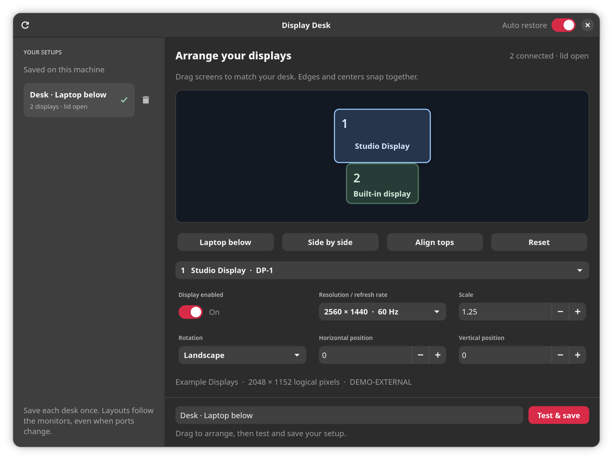

# Display Desk

A lightweight native display editor for **Ubuntu with Niri**. Arrange screens by dragging, save a setup for each desk, and restore the matching layout when monitors reconnect.



*The screenshot uses fictional monitors and profiles. No personal display information is included.*

## Install

Requires **Ubuntu 24.04 or later**, a running **Niri 25.11+** session, GTK 4.12+, and libadwaita 1.5+. Niri must already be installed and configured as your desktop session.

Download `display-desk_0.1.0_all.deb` from [Releases](https://github.com/elgemmy/display-desk/releases/latest), then run:

```sh
sudo apt install ./display-desk_0.1.0_all.deb
```

APT installs the Python and GTK dependencies. The package supports any CPU architecture supported by those dependencies. Niri is a recommended package rather than a hard dependency, so manually installed Niri also works.

Open **Display Desk** from the application menu, or run `display-desk`. Automatic restoration starts at your next Niri login. No account, API key, browser runtime, or pip installation is needed.

### Install from source

```sh
sudo apt install python3 python3-gi gir1.2-gtk-4.0 gir1.2-adw-1
git clone https://github.com/elgemmy/display-desk.git
cd display-desk
/usr/bin/python3 install.py
```

Run the user installer **without sudo**. It installs under `~/.local`, adds an application-menu entry, and adds a desktop shortcut when a desktop directory exists. Pass `--no-desktop-shortcut` to skip that shortcut.

If switching from the user installation to the `.deb`, close the app, run `/usr/bin/python3 install.py --uninstall` from the source checkout, then install the package. This avoids an older `~/.local/bin/display-desk` or local desktop entry shadowing the packaged version. Profiles and display settings are retained.

## Use

1. Drag screens to match your desk. Edges and centers snap together. Select a disabled display from the dropdown to enable it.
2. Adjust resolution, refresh rate, scale, rotation, or exact coordinates. **Laptop below**, **Side by side**, and **Align tops** provide quick arrangements. With the canvas focused, H/J/K/L or arrow keys move the selected screen by 10 logical pixels; Shift moves it by one.
3. Name the setup and choose **Test & save**. Confirm within 20 seconds to keep it. A separate watchdog restores the previous layout if the preview expires, including if the window closes unexpectedly.
4. Leave **Auto restore** on to restore a matching saved profile when those monitors reconnect. Click a saved setup to preview it manually.

Save each desk while its monitors are connected. Profiles match the complete monitor set and lid state; the most recently saved matching profile wins. External monitors are identified by manufacturer, model, and serial, so moving a distinct monitor between USB-C and HDMI ports keeps its profile usable. Identical or unidentifiable monitors need stable ports.

For an external-only setup, close the laptop lid and save the arrangement from an external screen. Niri handles the built-in panel's lid behavior. Save a separate profile for the same desk with the lid open if needed.

The interface adapts to Niri's tile size. Narrow tiles have a sidebar button for saved setups; controls wrap, short windows scroll, and the save action remains accessible. Display Desk does not set global keyboard shortcuts or change your window-tiling configuration.

## Local data and privacy

**The app has no network requests or telemetry.** Profiles are created on the computer running the app; none are bundled with the source or package.

| Local files | Contents |
| --- | --- |
| `~/.config/display-desk/profiles.json` | Setup names, monitor identities/serials, a machine identifier, and display settings |
| `~/.config/display-desk/backups/` | Backups of Niri configuration before saving |
| `~/.config/niri/display-desk.kdl` | The currently saved output configuration |
| `~/.local/state/display-desk/` | Preview recovery data and watcher locks |

These files can contain personal or machine information. Keep them local and redact them before including them in a bug report. Source, package, and CI artifact builds use explicit file lists; local screenshots, profiles, state, and build directories are excluded from Git.

Standard absolute `XDG_CONFIG_HOME`, `XDG_DATA_HOME`, and `XDG_STATE_HOME` overrides are respected. Empty or relative XDG directory values fall back to the standard locations.

On first save, the app prepends one managed include to your Niri configuration, validates the complete candidate, and makes a backup. Existing configuration remains below it. Unknown monitor combinations use Niri's existing behavior. The built-in panel is never permanently disabled in the generated file; external-only profiles are restored at runtime.

## Updates and removal

Install a newer `.deb` with the same `sudo apt install ./…deb` command. For a source installation, update the checkout and rerun `install.py`.

```sh
sudo apt remove display-desk
# Or, for a source installation:
/usr/bin/python3 install.py --uninstall
```

Removing the app retains your local profiles and display configuration. The managed include stays valid because its local file is retained. To remove its effect too, remove the Display Desk `include` line from Niri's config before deleting `~/.config/niri/display-desk.kdl`. Your older output blocks remain below it. Log out and back in to stop any already-running restoration process after removing the package.

## Development

```sh
/usr/bin/python3 -m unittest -v test_backend.py test_packaging.py
/usr/bin/python3 scripts/build_deb.py
```

The architecture-independent package is written to `dist/`. Building requires `dpkg-deb`; package tests also use `desktop-file-validate` from `desktop-file-utils`. Neither building nor testing needs root or changes live displays. CI runs the checks on Ubuntu 24.04. Package builds are reproducible with a fixed `SOURCE_DATE_EPOCH`.

Backend tests cover identity matching, geometry, config preservation, rollback, watcher behavior, and recovery after the preview owner exits. Package tests inspect extracted files, permissions, desktop entries, version output, and the GTK-free watcher launcher. Physical hotplug and lid behavior still need testing on the target hardware.

To produce a public screenshot with fictional data while running Niri:

```sh
/usr/bin/python3 scripts/capture_screenshot.py
```

Keep new screenshots synthetic. Do not commit real monitor profiles, personal configuration, private screenshots, or logs. See [SECURITY.md](SECURITY.md) for reporting details.

## License

[MIT](LICENSE).
